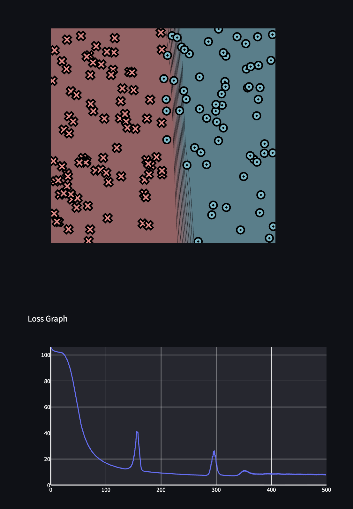
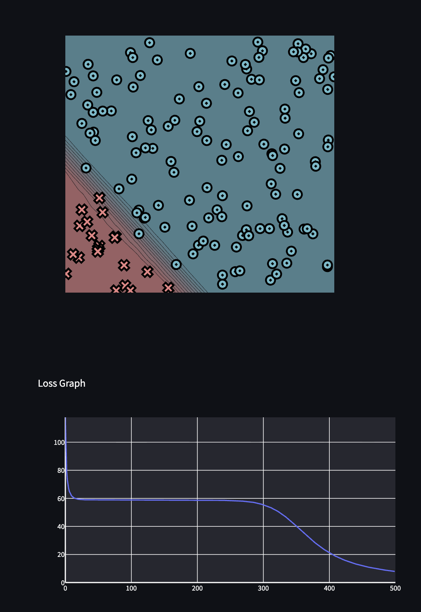
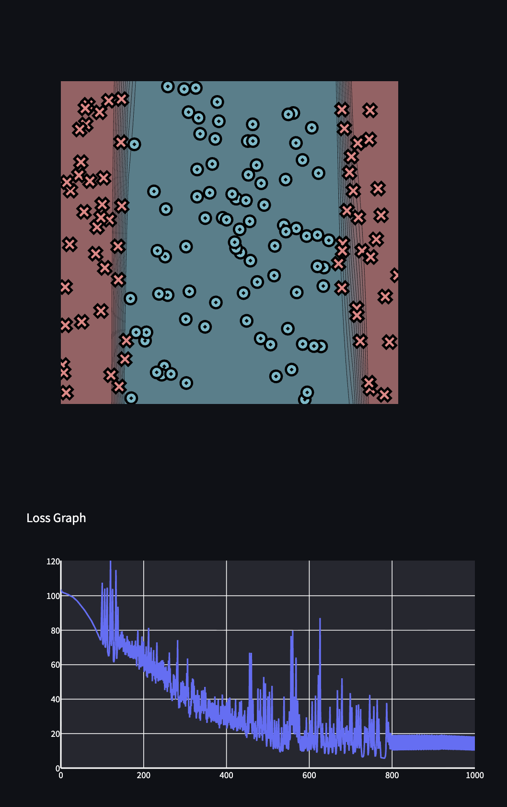
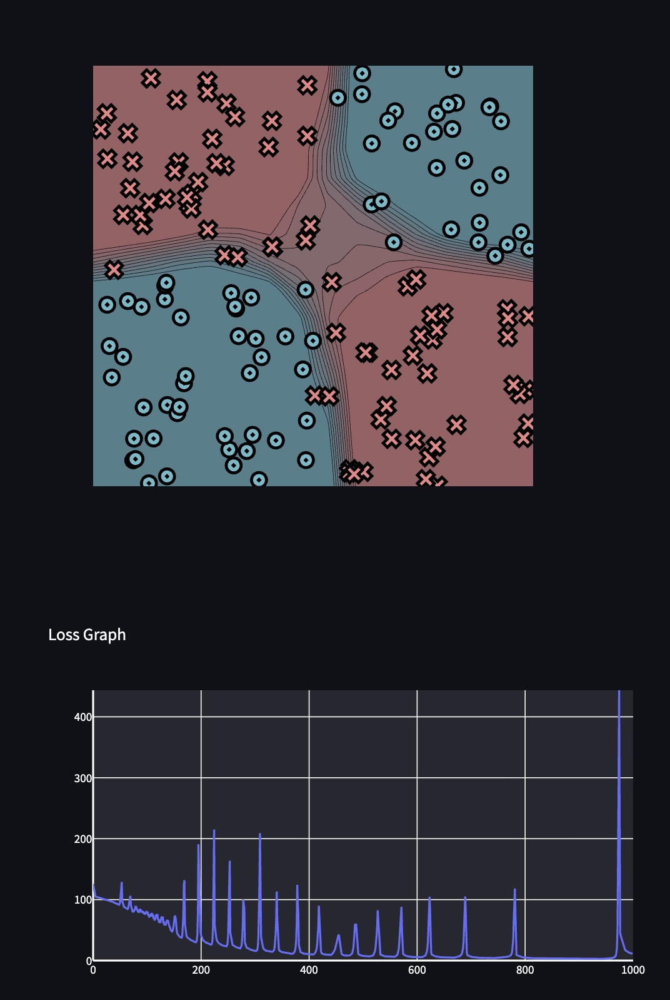

## Contents

- [Task 0.5: Visualization](#task-05-visualization)
- [Task 1.5: Training](#task-15-training)
  - [Simple](#simple)
  - [Diag](#diag)
  - [Split](#split)
  - [Xor](#xor)
- [Task 2.5: Training](#task-25-training)
  - [Tensor Simple](#tensor-simple)
  - [Tensor Diag](#tensor-diag)
  - [Tensor Split](#tensor-split)
  - [Tensor Xor](#tensor-xor)

## Task 0.5: Visualization

Parameters: `weight_0_0 = -10.00`, `weight_1_0 = 0.05`, `bias_0 = 5.05`


## Task 1.5: Training

### Simple
PTS: 150, HIDDEN: 2, RATE: 0.5, epochs: 500


```
Epoch: 50/500, loss: 87.85243481548076, correct: 128
Epoch: 100/500, loss: 33.92893188066495, correct: 136
Epoch: 150/500, loss: 22.240405641661685, correct: 140
Epoch: 200/500, loss: 17.02661571716005, correct: 142
Epoch: 250/500, loss: 15.172817566147954, correct: 143
Epoch: 300/500, loss: 13.703393615469158, correct: 144
Epoch: 350/500, loss: 12.530247300877111, correct: 144
Epoch: 400/500, loss: 11.801990204071396, correct: 144
Epoch: 450/500, loss: 11.213035873906431, correct: 145
Epoch: 500/500, loss: 10.624253330757167, correct: 146
```

### Diag
PTS: 150, HIDDEN: 2, RATE: 0.5, epochs: 500


```
Epoch: 50/500, loss: 27.86624859357958, correct: 140
Epoch: 100/500, loss: 7.314896280641765, correct: 150
Epoch: 150/500, loss: 4.0142539659231105, correct: 150
Epoch: 200/500, loss: 2.7827215351420502, correct: 150
Epoch: 250/500, loss: 2.1498261688578912, correct: 150
Epoch: 300/500, loss: 1.772286790620146, correct: 150
Epoch: 350/500, loss: 1.5237030605719915, correct: 150
Epoch: 400/500, loss: 1.3479470548814638, correct: 150
Epoch: 450/500, loss: 1.2166129739792795, correct: 150
Epoch: 500/500, loss: 1.1148580699633786, correct: 150
```


### Split
PTS: 150, HIDDEN: 3, RATE: 0.5, epochs: 1000


```
Epoch: 50/1000, loss: 100.7568272385153, correct: 90
Epoch: 100/1000, loss: 100.63375721970303, correct: 90
Epoch: 150/1000, loss: 100.34842009055326, correct: 90
Epoch: 200/1000, loss: 99.78920257181174, correct: 90
Epoch: 250/1000, loss: 98.50894833893999, correct: 92
Epoch: 300/1000, loss: 78.31141684741638, correct: 120
Epoch: 350/1000, loss: 67.43119951458965, correct: 120
Epoch: 400/1000, loss: 62.9982997683521, correct: 116
Epoch: 450/1000, loss: 54.748352743544494, correct: 122
Epoch: 500/1000, loss: 56.94570654294341, correct: 116
Epoch: 550/1000, loss: 52.618945622375165, correct: 117
Epoch: 600/1000, loss: 45.02917152030735, correct: 125
Epoch: 650/1000, loss: 38.14378247787156, correct: 128
Epoch: 700/1000, loss: 38.47438657935344, correct: 128
Epoch: 750/1000, loss: 37.45599642603649, correct: 129
Epoch: 800/1000, loss: 29.583060997483667, correct: 135
Epoch: 850/1000, loss: 23.15337321475854, correct: 139
Epoch: 900/1000, loss: 19.962562307147287, correct: 139
Epoch: 950/1000, loss: 24.386833517211453, correct: 135
Epoch: 1000/1000, loss: 18.238902161680265, correct: 139
```


### Xor
PTS: 150, HIDDEN: 10, RATE: 0.5, epochs: 1000


```
Epoch: 50/1000, loss: 59.68016546156006, correct: 122
Epoch: 100/1000, loss: 40.32903437614807, correct: 127
Epoch: 150/1000, loss: 39.05499572562959, correct: 134
Epoch: 200/1000, loss: 29.507884197262104, correct: 133
Epoch: 250/1000, loss: 26.528349563750325, correct: 136
Epoch: 300/1000, loss: 26.886855445415048, correct: 137
Epoch: 350/1000, loss: 20.520987821187624, correct: 140
Epoch: 400/1000, loss: 23.740820115780657, correct: 137
Epoch: 450/1000, loss: 19.217224202375373, correct: 141
Epoch: 500/1000, loss: 21.70045106595324, correct: 138
Epoch: 550/1000, loss: 22.440805555452396, correct: 137
Epoch: 600/1000, loss: 19.200101661737598, correct: 142
Epoch: 650/1000, loss: 17.684016514239108, correct: 143
Epoch: 700/1000, loss: 18.85071454755213, correct: 140
Epoch: 750/1000, loss: 22.51813442600012, correct: 138
Epoch: 800/1000, loss: 14.539553427206112, correct: 143
Epoch: 850/1000, loss: 15.232683983980474, correct: 142
Epoch: 900/1000, loss: 15.131250173443165, correct: 142
Epoch: 950/1000, loss: 11.62480764303702, correct: 148
Epoch: 1000/1000, loss: 12.087830106179059, correct: 145
```


## Task 2.5: Training

### Tensor Simple
PTS: 150, HIDDEN: 2, RATE: 0.5, epochs: 500

Time per epoch: 0.062s.



```
Epoch: 50/500, loss: 58.82139792214404, correct: 146
Epoch: 100/500, loss: 17.1216793893339, correct: 148
Epoch: 150/500, loss: 18.208479323384662, correct: 143
Epoch: 200/500, loss: 9.25812566100185, correct: 148
Epoch: 250/500, loss: 7.9345258860585, correct: 148
Epoch: 300/500, loss: 22.818673632126153, correct: 142
Epoch: 350/500, loss: 11.195121286960347, correct: 145
Epoch: 400/500, loss: 8.78263380802966, correct: 147
Epoch: 450/500, loss: 8.428360872163227, correct: 147
Epoch: 500/500, loss: 8.16703356162435, correct: 147
```

### Tensor Diag
PTS: 150, HIDDEN: 2, RATE: 0.5, epochs: 500

Time per epoch: 0.064s.



```
Epoch: 50/500, loss: 58.90291368624585, correct: 130
Epoch: 100/500, loss: 58.88869417095461, correct: 130
Epoch: 150/500, loss: 58.866819074717526, correct: 130
Epoch: 200/500, loss: 58.795202071172554, correct: 130
Epoch: 250/500, loss: 58.44796642417955, correct: 130
Epoch: 300/500, loss: 55.51681029703426, correct: 130
Epoch: 350/500, loss: 40.62876304366906, correct: 130
Epoch: 400/500, loss: 21.48052610767168, correct: 130
Epoch: 450/500, loss: 12.07118462923181, correct: 149
Epoch: 500/500, loss: 7.940722364592381, correct: 149
```


### Tensor Split
PTS: 150, HIDDEN: 5, RATE: 0.5, epochs: 1000

Time per epoch: 0.187s.



```
Epoch: 50/1000, loss: 94.21004050628207, correct: 109
Epoch: 100/1000, loss: 92.59485101917777, correct: 86
Epoch: 150/1000, loss: 70.03377651538351, correct: 110
Epoch: 200/1000, loss: 62.28473660611907, correct: 112
Epoch: 250/1000, loss: 49.1057713465042, correct: 118
Epoch: 300/1000, loss: 36.94463802423876, correct: 129
Epoch: 350/1000, loss: 33.93821400972763, correct: 131
Epoch: 400/1000, loss: 26.342247222824057, correct: 138
Epoch: 450/1000, loss: 17.484295076711675, correct: 144
Epoch: 500/1000, loss: 23.502949860255203, correct: 139
Epoch: 550/1000, loss: 10.671854764040084, correct: 147
Epoch: 600/1000, loss: 10.37114584474529, correct: 147
Epoch: 650/1000, loss: 19.656085479561366, correct: 141
Epoch: 700/1000, loss: 43.56560044293357, correct: 134
Epoch: 750/1000, loss: 11.769865454954587, correct: 147
Epoch: 800/1000, loss: 11.47067234177264, correct: 148
Epoch: 850/1000, loss: 10.448295589898791, correct: 146
Epoch: 900/1000, loss: 19.061593804844176, correct: 145
Epoch: 950/1000, loss: 11.787532612110258, correct: 147
Epoch: 1000/1000, loss: 10.155666449789209, correct: 146
```


### Tensor Xor
PTS: 150, HIDDEN: 10, RATE: 0.5, epochs: 1000

Time per epoch: 0.523s.



```
Epoch: 50/1000, loss: 92.59708281646597, correct: 97
Epoch: 100/1000, loss: 81.35914834014699, correct: 97
Epoch: 150/1000, loss: 56.53704051264425, correct: 122
Epoch: 200/1000, loss: 47.10894060154179, correct: 136
Epoch: 250/1000, loss: 29.1615299914193, correct: 135
Epoch: 300/1000, loss: 15.727287001949515, correct: 145
Epoch: 350/1000, loss: 14.152762217874313, correct: 145
Epoch: 400/1000, loss: 10.460465841239941, correct: 148
Epoch: 450/1000, loss: 22.344338978770352, correct: 140
Epoch: 500/1000, loss: 7.736457114085136, correct: 147
Epoch: 550/1000, loss: 6.243895614199379, correct: 150
Epoch: 600/1000, loss: 5.312745179517884, correct: 150
Epoch: 650/1000, loss: 5.106232267590088, correct: 150
Epoch: 700/1000, loss: 6.433691730949297, correct: 149
Epoch: 750/1000, loss: 4.170683104971875, correct: 150
Epoch: 800/1000, loss: 4.872849878581391, correct: 150
Epoch: 850/1000, loss: 3.208312729523346, correct: 149
Epoch: 900/1000, loss: 2.8637657588470704, correct: 149
Epoch: 950/1000, loss: 3.008268172361151, correct: 149
Epoch: 1000/1000, loss: 11.05860213633431, correct: 147
```